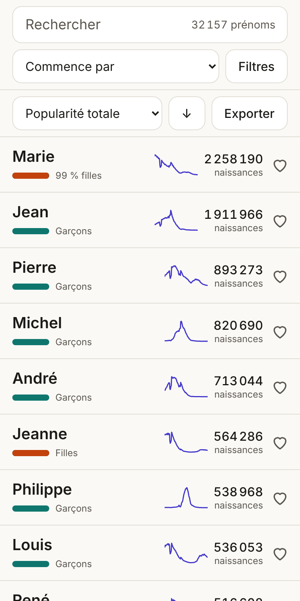
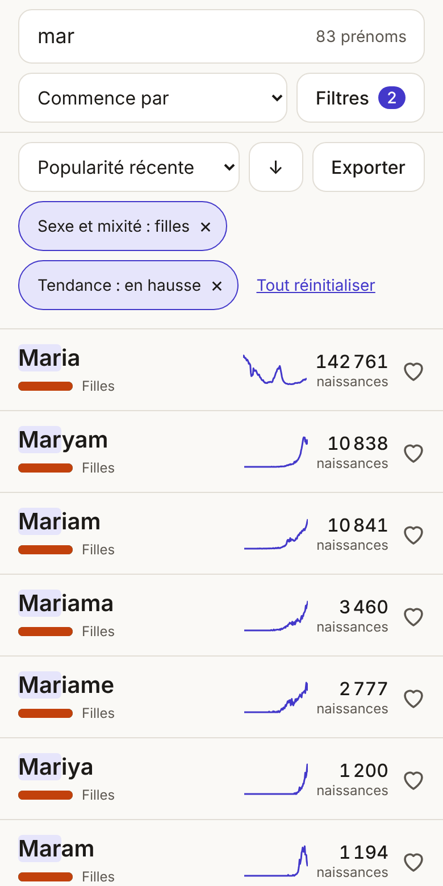
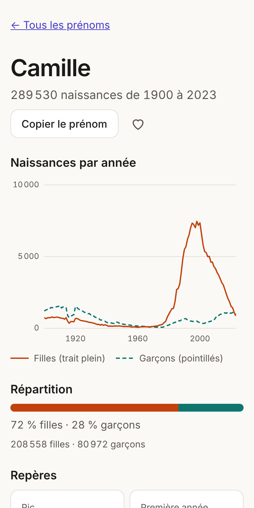
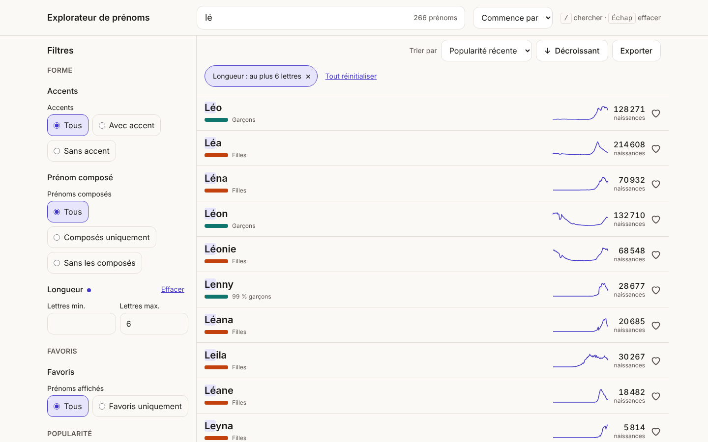
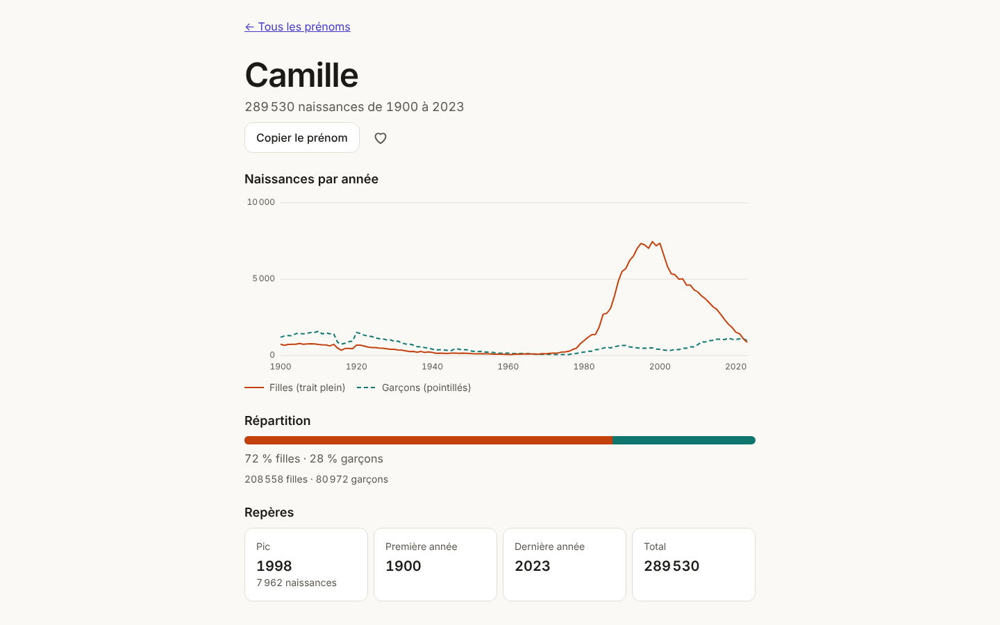
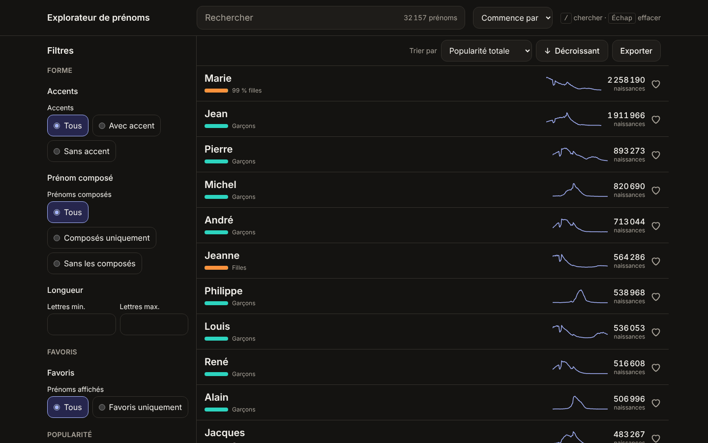

# Explorateur de prénoms

Rechercher, filtrer et trier les 32 157 prénoms donnés en France de 1900 à 2023, d'après le
fichier des prénoms de l'Insee. L'application est entièrement statique : elle charge les données
dans le navigateur, sans serveur ni base de données.

**Site publié : https://pierrecyrildecrock.github.io/Prenoms/**

|                             Liste                             |                             Recherche et filtres                             |                         Fiche                         |
| :-----------------------------------------------------------: | :--------------------------------------------------------------------------: | :---------------------------------------------------: |
|  |  |  |



<details>
<summary>Autres captures : tiroir de filtres, fiche sur ordinateur, thème sombre</summary>





</details>

## Ce que fait l'application

- **Recherche** en direct, insensible à la casse et aux accents : commence par, contient, finit par.
- **Douze filtres** combinables : initiale, longueur, lettres incluses ou exclues, sexe et mixité,
  popularité totale ou sur une période, année du pic, tendance, prénoms composés, accents,
  favoris.
- **Six tris**, dans les deux sens : alphabétique, popularité totale, popularité récente,
  tendance, année du pic, longueur.
- **Fiche d'un prénom** : courbe annuelle des naissances par sexe, pic, première et dernière
  année, répartition filles et garçons.
- **Lien partageable** : la recherche, les filtres et le tri sont dans l'adresse. Par exemple,
  [les prénoms de filles en hausse commençant par « mar »](https://pierrecyrildecrock.github.io/Prenoms/#/?q=mar&f.gender=f&f.trend=up&s=recentPopularity&d=desc).
- **Favoris** conservés sur l'appareil, et **export** de la liste affichée en CSV (pour Excel) ou
  en JSON.
- Utilisable sur téléphone comme sur ordinateur, au clavier, en thème clair ou sombre, avec un
  réglage pour réduire les animations.

## Développement

Prérequis : Node.js 22.

```bash
npm install
npm run dev        # serveur de développement
npm test           # tests unitaires et de composants (Vitest)
npm run lint       # ESLint et Prettier
npm run build      # vérification des types, puis build statique dans dist/
```

| Commande                | Effet                                                                   |
| ----------------------- | ----------------------------------------------------------------------- |
| `npm run preview`       | Sert `dist/`                                                            |
| `npm run e2e`           | Scénarios Playwright (mobile et desktop) sur un build local             |
| `npm run e2e:live`      | Les mêmes scénarios contre le site publié                               |
| `npm run lighthouse`    | Audit Lighthouse mobile du site publié (variable `CHROME_PATH`)         |
| `npm run build:data`    | Régénère les données depuis le CSV de l'Insee                           |
| `npm run validate:data` | Vérifie que les sommes du JSON égalent celles du CSV                    |
| `npm run capture`       | Régénère les icônes, l'image d'aperçu de lien et les captures du README |

Le site est servi sous le sous-chemin `/Prenoms/`. Pour le reproduire en local :

```bash
VITE_BASE=/Prenoms/ npm run build && VITE_BASE=/Prenoms/ npm run preview
```

### Déploiement

Chaque push sur `main` lance le workflow [`deploy.yml`](.github/workflows/deploy.yml) : lint,
tests, build, puis publication de `dist/` sur GitHub Pages. La page de diagnostic
[`#/dev`](https://pierrecyrildecrock.github.io/Prenoms/#/dev) affiche le commit publié.

## Régénérer les données

Les données publiées ([`public/data/insee.json`](public/data/insee.json)) sont versionnées dans
le dépôt : le build en ligne ne les régénère pas. Pour les mettre à jour :

1. Télécharger le fichier national au format CSV sur la page
   [Fichier des prénoms](https://www.insee.fr/fr/statistiques/8205621) de l'Insee.
2. Le décompresser dans `data/raw/` (dossier ignoré par git et jamais publié).
3. Lancer `npm run build:data`, puis `npm run validate:data`.
4. Commiter `public/data/insee.json` et `public/data/insee.report.json`.

Le script affiche un rapport : nombre de prénoms, plage d'années, taille du fichier et lignes
exclues. Dans l'édition actuelle, 39 704 lignes d'année de naissance inconnue (926 369
naissances) et le regroupement des prénoms rares (1 799 189 naissances) sont exclus, et les
graphies qui ne diffèrent que par les accents (LEA, LÉA) sont fusionnées sous la plus fréquente.

## Architecture

Le cœur de l'application (`src/core`) ne connaît ni l'Insee ni aucun filtre : il définit des
contrats, et chaque module s'inscrit dans un registre qui le découvre automatiquement.

| Pour ajouter…    | Créer un fichier dans…      |
| ---------------- | --------------------------- |
| une source       | `src/sources/<id>/index.ts` |
| un champ calculé | `src/derived/<id>.ts`       |
| un filtre        | `src/filters/<id>.tsx`      |
| un tri           | `src/sorts/<id>.ts`         |

Documentation :

- [docs/PLAN.md](docs/PLAN.md) : feuille de route et choix techniques ;
- [PROGRESS.md](PROGRESS.md) : avancement, mesures et décisions de chaque étape ;
- [CLAUDE.md](CLAUDE.md) : conventions du code, à lire avant de contribuer.

Technologies : Vite, React, TypeScript, Tailwind CSS, Zustand, TanStack Virtual, Motion,
idb-keyval, Vitest, Playwright.

## Données, crédits et licence

**Source : Insee, [Fichier des prénoms](https://www.insee.fr/fr/statistiques/8205621)**, édition
parue le 8 juillet 2024 (naissances de 1900 à 2023).

Selon les [mentions légales de l'Insee](https://www.insee.fr/fr/information/2008466), ces données
sont mises à disposition sous la
[Licence Ouverte / Open Licence version 2.0](https://www.etalab.gouv.fr/licence-ouverte-open-licence)
(Etalab), qui autorise leur réutilisation libre à condition de mentionner la source et la date de
mise à jour, et de ne pas en altérer le sens.

À savoir sur ces données, d'après l'Insee : le fichier recense des naissances et non des personnes
vivantes ; il est établi à partir des bulletins de naissance, et son exhaustivité n'est pas
garantie avant 1946. Les traitements appliqués ici (exclusions et fusions décrites plus haut) font
que les totaux affichés sont légèrement inférieurs à ceux du fichier d'origine.

Police : [Inter](https://rsms.me/inter/), sous licence SIL Open Font License 1.1.
